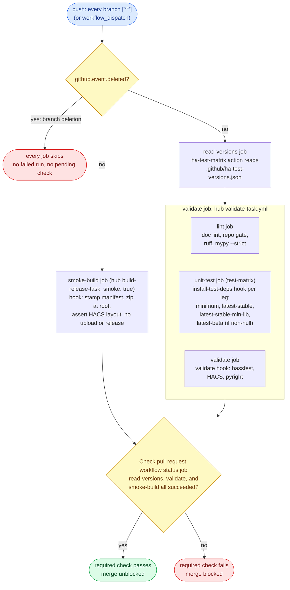
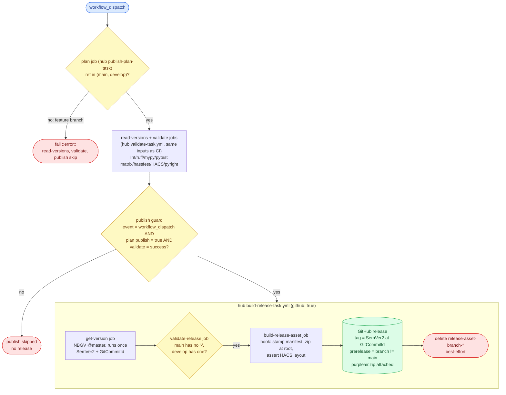
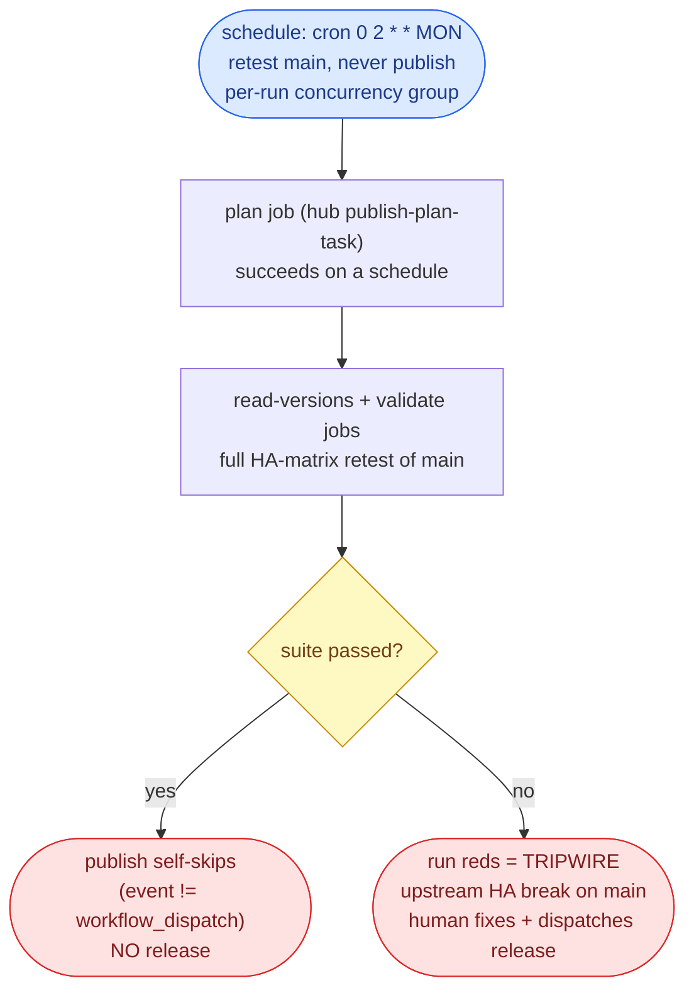
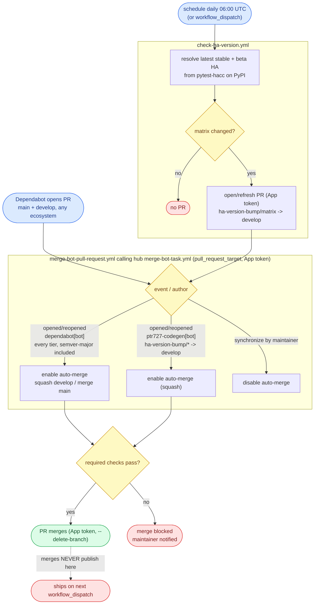

# WORKFLOW.md

The single guide for this repo's CI/CD **workflows** (GitHub Actions): **code style**, **architecture**, a
**behavioral contract** (expected inputs and outputs), and a **test methodology**. Source style lives in
[`CODESTYLE.md`][codestyle]. This file covers everything under [`.github/workflows/`][workflows-dir] and the
composite actions under [`.github/actions/`][actions-dir]. Those are the
[`build-release-asset`][build-release-asset], [`install-test-deps`][install-test-deps], and
[`validate`][validate-hook] hooks the hub tasks call, and the [`ha-test-matrix`][ha-test-matrix] action.

It **describes required outcomes, not a required implementation.** A workflow is correct when it satisfies
the contract (section 4), whatever shape its YAML takes. Section 2 keeps workflows legible. Section 3 is
the model. Section 4 is what they must *do*. Sections 5 and 6 are how to verify it and the configuration it
assumes. Each guarantee names the **failure it prevents**, so the reason survives a reimplementation.

## 0. The model at a glance

homeassistant-purpleair ships **one target**: a **Home Assistant custom integration** distributed through
[HACS][hacs] as a zip release. The integration's Python lives in
[`custom_components/purpleair/`][integration-dir]. There is no compiled artifact. HACS is a
**pull** distributor - it installs from a GitHub Release asset - so releasing is **dispatch-only**: a
maintainer ships on demand, and ordinary merges never publish. Two workflows do the publishing work, plus a
daily tracker that keeps the test matrix current:

- **CI** ([`test-pull-request.yml`][test-pull-request-yml]) runs on **push to every
  branch**: it validates (lint, type-check, the HA-version test matrix) and proves the release zip builds,
  publishing nothing. A pull request merges only when its required check is green.
- **The publisher** ([`publish-release.yml`][publish-release-yml]) is **dispatch-only**,
  plus a **retest-only weekly schedule**. A `workflow_dispatch` from `main` cuts a **stable** release (clean
  NBGV `X.Y.Z`); a dispatch from `develop` cuts a **prerelease** (`X.Y.Z-g<sha>`). The **weekly schedule**
  re-runs the full test suite against the live HA matrix and **never publishes** - it is the main-side drift
  alarm complementing the tracker. There is **no `push` trigger**: a merge to `main` or `develop` never cuts
  a release.
- **The HA-version tracker** ([`check-ha-version.yml`][check-ha-version-yml]) runs
  **daily**: it resolves the latest stable and beta Home Assistant versions from
  `pytest-homeassistant-custom-component` on PyPI and records them in `.github/ha-test-versions.json` via an
  App-signed, auto-merged bump PR to `develop`. It **retests**, it does **not** publish - a breaking HA
  release reds the bot PR's CI for a human to fix.

There is no publish-on-merge, no per-push release, and no two-branch matrix - one run builds, versions, and
publishes exactly its own trigger ref. Dependabot pull requests merge themselves once their checks pass.

### Glossary

- **Entry workflow** - has `push` / `schedule` / `workflow_dispatch` / `pull_request_target` triggers. The
  orchestrator that an event or a person starts.
- **Reusable workflow (task)** - a `workflow_call` workflow invoked through a `uses:` reference, never
  triggered directly. File ends in `-task.yml`.
- **Target** - the one shipped output: the **HACS zip** `purpleair.zip`. The hub's `build-release-task.yml`,
  reached by pin, builds it through this repo's
  [`build-release-asset`][build-release-asset] hook and attaches it to a GitHub
  Release.
- **Validate task** - the hub's `validate-task.yml`, reached by pin with this repo's inputs. Its `lint` job
  runs the doc lint, ruff, and `mypy --strict`. Its `unit-test` job runs the HA-version pytest matrix
  (Codecov upload). Its `validate` job runs hassfest, HACS validate, and pyright through this repo's
  [`validate`][validate-hook] hook. CI runs the task on every push, and the publisher runs it with the
  identical inputs before any release.
- **HA test matrix** - the pytest legs. The [`ha-test-matrix`][ha-test-matrix] action reads them from
  `.github/ha-test-versions.json` at run time. Each caller's `read-versions` job runs it, and the caller's
  `validate` job passes the legs to the validate task as its `test-matrix` input. The task calls the
  [`install-test-deps`][install-test-deps] hook once per leg.
- **No-publish build** - a build of `purpleair.zip` that proves the release pipeline still produces a valid
  HACS zip, with no upload and no release. CI's `smoke-build` job drives it through the hub task's
  `smoke: true` input. The publisher runs no smoke build, since its `publish` job builds the zip for real.
- **HACS zip** - `purpleair.zip` with the integration's files **at the archive root** (`manifest.json`,
  `__init__.py`, ...), no `purpleair/` wrapper - the layout HACS requires when `hacs.json` sets
  `zip_release: true` + `filename`, since HACS extracts the asset directly into
  `<config>/custom_components/<domain>/`. The build asserts this layout and fails on a regression.
- **Transfer artifact** - a workflow artifact handing a file between jobs of one run. Here it is
  `release-asset-<branch>-build-release-asset`, which carries `purpleair.zip` from the hub task's
  `build-release-asset` job to its `github-release` job. The durable copy lives on the GitHub release.
- **Shipped version** - NBGV's `SemVer2`, computed from `version.json` (`1.0` floor plus a `versionHeightOffset`
  of `-1`, so the first release of a floor series is `.0`) plus git height. It is
  stamped into `manifest.json` at build time and used as the release tag. Independent of the integration's
  own dependency pins (`ptr727-aiopurpleair`) and the HA test-matrix versions.
- **GitHub App token** - a short-lived installation token from `actions/create-github-app-token`, minted
  from the App credentials (`CODEGEN_APP_CLIENT_ID` / `CODEGEN_APP_PRIVATE_KEY`). The merge-bot and the
  tracker use it, not `GITHUB_TOKEN`: a `GITHUB_TOKEN` push does not trigger downstream workflows, and that
  token is read-only on Dependabot pull requests.

## 1. Purpose and how to use this document

- **Contract, not implementation.** Conform to the *outcomes* in section 4 and the *architecture* in section
  3. Job names and file layout may vary; the input/output behavior may not.
- **"Operational" - the one definition.** The repo is **operational** when every applicable section-4
  guarantee holds, every applicable section-5B scenario's observed output equals its expected output
  (corroborated by a 5C live probe where a live signal exists), and the section-6 configuration is in place.
  Anything else is **not operational**.
- **Defect vs N/A.** An item is **N/A** only when this repo has no such concern (e.g. a fork-PR scenario,
  since a fork cannot push here; or a NuGet/Docker publish, since this repo ships a HACS zip). A construct
  required by an applicable guarantee but absent is a **defect**.
- **Default branch is `main`.** Guarantees say "default branch" portably. The hub's `publish-plan-task.yml`
  writes the literal `main` in its dispatch gate, and this repo writes the anchored `^refs/heads/main$` in
  `version.json`'s `publicReleaseRefSpec`. The hub task derives `prerelease` as `branch != 'main'` from the `branch` input.
- **The verbs.** **Audit** (static 5A, configuration 5D), **Test** (trace, 5B), **Assess** (verdict).

## 2. Workflow style conventions

Legibility rules. Necessary but not sufficient: a perfectly styled workflow can still violate section 4.

- **Action pinning.** Pin every action to a commit SHA with a trailing `# vX.Y.Z` comment. Use `# vX` only
  when the upstream floating major tag has no specific patch SHA. The **sole exception is
  `dotnet/nbgv@master`** (see D9.1). Actions that float a vendor `@master` ref by design
  (`home-assistant/actions/hassfest@<sha> # master`) stay SHA-pinned with the `master` provenance noted in
  the comment.
- **Filename.** Reusable workflows end in `-task.yml`; entry workflows end in what they do
  (`-pull-request.yml`, `-release.yml`, `check-ha-version.yml`). A `-task.yml` is `uses:`-d, never triggered
  directly.
- **Workflow `name:`.** Reusable names end in **"task"**, entry names in **"action"**.
- **Job and step `name:`.** Every job `name:` ends in **"job"**, every step `name:` in **"step"**, the
  aggregator included (`Check pull request workflow status job`). A job name also bound as a ruleset
  required-check `context:` is codified in the hub's `repo-config/` payloads and changed only **in lockstep**
  with the live ruleset.
- **Concurrency.** Every entry workflow declares a `concurrency` group. CI and the tracker use
  `group: '${{ github.workflow }}-${{ github.ref }}'` (the tracker omits the ref, keying on the workflow
  alone since it has one rolling branch) with `cancel-in-progress: true`. The **publisher** keeps the
  ref-scoped group with `cancel-in-progress: false`, so no publish is cancelled mid-release, which could
  leave a half-created release. Its retest-only schedule appends `github.run_id`, so it never shares a group
  with a pending dispatch (D7.1). The **merge-bot** keys on the PR number with `cancel-in-progress: false`.
- **Shells.** Every multi-line bash `run:` starts with `set -Eeuo pipefail`.
- **Conditionals.** Multi-line `if:` uses the folded scalar `if: >-`.
- **Boolean inputs.** A boolean used by both `workflow_call` and `workflow_dispatch` is declared in both
  trigger blocks and compared against `true` and `'true'` (`workflow_dispatch` delivers the string).
- **Reusable-workflow permissions.** Job-level `permissions:` are validated before `if:`, so even a skipped
  job needs valid permissions. Grant least privilege; a callee's extra scope (e.g. `contents: write` to
  create the release, `actions: write` to delete artifacts) is granted by the caller at the `uses:` job.
- **Allowlist `success` and `skipped` explicitly** across an optional dependency: use
  `(needs.X.result == 'success' || needs.X.result == 'skipped')`, not `!= 'failure'`. A job that must run
  when an upstream `needs:` was *skipped* wraps its `if:` in `always() &&` so GitHub's skipped-dependency
  auto-skip does not suppress it. The CI aggregator is the one such job here.
- **Line endings.** Workflow YAML and JSON follow [`.editorconfig`][editorconfig] (LF). Preserve on
  every edit.

## 3. Architecture

### Two workflows: CI on push, publishing on dispatch

CI ([`test-pull-request.yml`][test-pull-request-yml]) and the publisher
([`publish-release.yml`][publish-release-yml]) are separate workflows with separate
concurrency, so they never race. CI re-tests every pushed tree and never publishes; the publisher releases
only on a maintainer's dispatch (and retests, never publishes, on its weekly schedule). *Prevents a merge
from silently cutting a release, and a CI run from racing a publish on the same ref.*

### The publisher is dispatch-only; the schedule retests and stops

A publish happens **only** on `workflow_dispatch`. The publisher's `plan` job, the hub's
`publish-plan-task.yml`, asserts the dispatch ref is `main` or `develop` and fails loudly otherwise. The
trigger ref alone decides the version class (`main` -> stable clean SemVer, `develop` -> prerelease
`-g<sha>`, classified natively by NBGV from `github.ref`). The single `publish` job is gated
`github.event_name == 'workflow_dispatch'`, so the **weekly schedule never publishes**. On the schedule the
plan succeeds and reports `publish=true`, its Docker-refresh case, so that event gate is the one that stops
it. The `validate` job runs on every successful plan rather than on that output, and `publish` self-skips.
The schedule's job is to retest the shipped `main` against the live HA matrix. Upstream HA drift that breaks
the released integration then reds a run a maintainer can see. *Prevents per-merge release churn, a blind
scheduled republish, and a develop tip dispatched as stable.*

### Versioning: compute once, thread everywhere

NBGV runs in exactly **one** job, the hub's `get-version-task.yml` reached by pin. It classifies from
`github.ref` on a checkout of the triggering commit, and emits `SemVer2`, which is also the release tag, and a
derived `Prerelease` flag. Those thread to every consumer via `outputs:` / `needs:`. No other job re-invokes NBGV
(the hub's `build-release-task` calls `get-version-task` once and reads its outputs in both the asset build
and the release jobs). `main` (the public ref, `publicReleaseRefSpec = ^refs/heads/main$`) builds a clean `X.Y.Z`, and every
other branch a prerelease `X.Y.Z-g<sha>`. *Keeps the stamped `manifest.json` version and the release tag in
agreement.* NBGV needs only `version.json` (floor `1.0`, `versionHeightOffset -1`) and git height, so it works although the repo
builds no .NET assembly. The release's `prerelease` boolean is `branch != 'main'`. Before the zip is built, the hub task's
`validate-release` job refuses a run where `SemVer2` disagrees with it. A `main` version may carry no `-`,
and every other branch's version must carry one.

### Validate at entry, then build the zip

The hub's `build-release-task` versions once and runs `validate-release` before any build. Its
`build-release-asset` job then runs this repo's hook, which stamps `manifest.json` with the NBGV `SemVer2`.
The checked-in value is the all-zero placeholder version, and the rewrite is on the runner only, with no commit.
The hook zips `custom_components/purpleair/` **at the archive root** and **asserts the layout**
(`manifest.json` + `__init__.py` present at root, no `purpleair/` wrapper). A HACS double-nesting
regression fails the build rather than shipping a broken install. The task uploads the zip only on a
non-smoke run, and its `github-release` job runs only when `github` is true and `smoke` is false.

### Fast CI feedback, head-resolved

CI runs on push to every branch (`push: ['**']`), so GitHub head-resolves the local `./.github/actions/...`
hooks from the pushed head. A pull request that edits a hook therefore tests its own copy. The hub tasks are
reached by pin, so a change to one arrives as a pin bump that the same push exercises. CI runs the
`read-versions` job, the hub validate task in its `validate` job, and the no-publish zip build in its
`smoke-build` job. One aggregator job, `Check pull request workflow status job`, is the ruleset-bound
required check and gates the merge. It `needs:` all three and fails on any result but `success`. A
branch-deletion push (all-zeros `github.sha`) is skipped by a `!github.event.deleted` guard on
`read-versions`, `smoke-build`, and the aggregator. The `validate` job inherits the skip through `needs:`,
so a deletion never runs a failing build or leaves the required check pending. The publisher runs the
**same** hub validate task with the same inputs before any release, so the CI gate and the publish gate are
identical.

### The validate suite

The hub's `validate-task.yml` and this repo's hooks hold the Python analog of a validate-plus-smoke pair. Both
callers pass `python-directories: .`, `python-versions: ["3.14"]`, and the `read-versions` matrix as
`test-matrix`.

- **Doc lint** in the task's `lint` job: markdownlint, cspell over `README.md` and `HISTORY.md`, actionlint,
  editorconfig-checker, and shellcheck plus `shfmt -d` over every tracked shell script. Its repository gate
  shellchecks and schema-checks each composite action, and checks action pins and line endings.
- **ruff** (`ruff check` + `ruff format --check`) and **mypy** (`--strict`, Platinum quality-scale
  strict-typing) in the same `lint` job, against `requirements*.txt` and so against `latest-stable`. The
  `[tool.mypy]` section in `pyproject.toml` selects mypy and carries its settings. **pyright** (the engine
  behind Pylance, config in `pyrightconfig.json`) runs in the [`validate`][validate-hook] hook against the
  same pins, since the task runs one type checker.
- **pytest matrix** in the task's `unit-test` job over the HA versions in `.github/ha-test-versions.json`,
  in three slots. `minimum` is hand-maintained and must match `hacs.json`'s `homeassistant`. `latest-stable`
  and `latest-beta` are bot-maintained, and the beta slot is omitted when null. The
  [`install-test-deps`][install-test-deps] hook installs each leg's `homeassistant==` and
  `pytest-homeassistant-custom-component==` pins over the base install. The task runs pytest under the
  `--cov` selector in `pyproject.toml` and uploads coverage to Codecov, flagged `python-<label>` per leg.
  `latest-stable` runs a second leg, `latest-stable-min-lib`. That leg and `minimum` replace the
  `requirements-test.txt` pin of `ptr727-aiopurpleair` with the manifest's `>=` minimum. The hook also runs
  `mypy --strict` against that minimum before the tests. All three slots gate equally.
- **hassfest** (`home-assistant/actions/hassfest`) and **HACS validate** (`hacs/action`, integration
  category) in the `validate` hook, the publish-validation checks the HACS / HA ecosystems require.
- the **no-publish build** of `purpleair.zip` (the hub's `build-release-task` with `smoke: true`) in CI's
  `smoke-build` job, beside the validate task rather than after it. The publisher runs none, so `publish`
  builds the release zip once, for real.

### Resource lifecycle

The hub task's `release-asset-<branch>-build-release-asset` upload is an intra-run transfer artifact, and the
durable copy is the GitHub release asset. The upload sets `retention-days: 1` as a backstop. The task's
`github-release` job deletes the artifacts matching `release-asset-<branch>-` by name once the release is
created, best-effort, so diagnostic artifacts survive. See D5.

### Self-testing workflows, and the required-context invariant

A pull request exercises its own workflow files. No change waits to reach `main` first.

- **CI runs on `push` to every branch.** GitHub head-resolves the local `./.github/actions/...` hooks from
  the pushed head, so a PR that edits a hook tests its own copy. The push run is the **sole producer** of the
  aggregator's ruleset-bound `context:`, on the head SHA branch protection evaluates. CI never publishes.
- **Dependabot and tracker PRs are in-repo branches**, validated head-resolved by their push the same way
  (Dependabot with a read-only token and the Dependabot secret store, enough for the gate).
- **A dispatched publish uses that branch's workflows**, so a workflow change is usable on the branch that
  introduces it.
- **Forks are the documented exception.** A fork cannot push here, so its PR produces no run and no
  aggregator check, and a maintainer lands the change on an in-repo branch before merging. See D6.

### Self-sufficiency: automatic updates and HA-version tracking

- **Dependabot pull requests merge themselves** once the required checks pass - every tier, **semver-major**
  included: the required checks are the gate, not the version bump. Dependabot is **dual-target** (`main` **and**
  `develop`) so both branches stay current and never drift apart; a `develop` bump is sync-only and never
  publishes (merges do not publish here), and a `main` bump likewise ships only when a maintainer next
  dispatches a release. A merged bump does **not** itself publish.
- **The HA-version tracker** ([`check-ha-version.yml`][check-ha-version-yml]) runs daily,
  resolves the latest stable and beta HA from `pytest-homeassistant-custom-component` on PyPI, and opens
  **one** bundled rolling PR (`ha-version-bump/matrix`) to `develop` via the App, rewriting
  `.github/ha-test-versions.json`. The merge-bot's `ha-version-bump/` rule auto-merges it on green. It
  **retests** (a breaking HA release reds the bot PR's CI for a human), it does **not** publish. The
  publisher's weekly schedule is the main-side complement, retesting the shipped `main` against the live
  matrix.

This repo has **no codegen** (no generated source) and **no NuGet/Docker** target. A person steps in only
for a breaking change (a red check) or to dispatch a release.

### The single-target release

The repo produces exactly one shipped artifact, the HACS zip. `publish` calls the hub's
`build-release-task` with `github: true` and only `enable_release_asset` on. Its `github-release` job
downloads the `release-asset-<branch>-*` artifacts and `softprops/action-gh-release` creates the tag and
release with auto-generated notes. It attaches `purpleair.zip`, `README.md`, and `LICENSE`, with
`fail_on_unmatched_files: true`, so the zip must exist. `target_commitish` is set explicitly to the
`get-version` job's `GitCommitId`, the dispatched commit, rather than the API's default of the repository
default branch. The GitHub-release `prerelease` boolean is `branch != 'main'`. There is no NuGet push, no
Docker push, and no OIDC, so the release is keyless and GitHub-native.

### Flow diagrams

Four diagrams trace the architecture above: the pull-request gate, the dispatch-only publisher, the
weekly retest tripwire, and the bot automation. They depict the same outcomes that the section 4 contract specifies, drawn
from the workflow YAML; if a diagram and a guarantee disagree, one of them is a defect. Triggers are
blue, gates yellow, durable/published outputs green, and stop/skip outcomes red.

**Pull request (CI), `test-pull-request.yml`.** Every push reads the HA matrix and runs the hub validate
task by pin with this repo's hooks. The task covers the doc lint, ruff, mypy, the HA-version pytest matrix,
hassfest, HACS, and pyright. A no-publish zip build runs beside it, and a single aggregator produces the
ruleset-bound required check (D1, D6).

**Publish (dispatch-only), `publish-release.yml` -> the hub's `build-release-task.yml`.** ONLY a
`workflow_dispatch` reaches `publish`. The `plan` job restricts the dispatch ref to `main` or `develop`, and
the validate task gates it. NBGV versions once, and the GitHub release is cut with `purpleair.zip` attached
(D2, D3, D4).

**Weekly retest tripwire - `publish-release.yml` on `schedule`.** The Monday cron retests the shipped
`main` against the live HA matrix and NEVER publishes. The plan succeeds, `validate` runs on it, and
`publish` self-skips because the event is not a dispatch. The run takes a per-run concurrency group, so it
never replaces a pending dispatch. A red run flags an upstream Home Assistant break for a human to fix and
release manually (D4.1, D4.5).

**Automation - Dependabot + HA-version tracker + merge-bot.** Daily the tracker resolves the latest HA
pins and opens a rolling bundled PR; Dependabot opens its own PRs; the merge-bot enables auto-merge (or
disables it on a maintainer push). A merged change NEVER publishes here - it ships on the next dispatch
(D8).

## 4. Behavioral contract - expected outcomes

Each is a **MUST**, stated as input -> output plus the failure it prevents.

### D0 - Architecture

- **D0.1 CI is one run, one branch.** Input: any push. Output: `test-pull-request` validates exactly
  `github.ref_name` and publishes nothing. *Prevents cross-branch ref mixing in CI.*
- **D0.2 The publisher builds one branch: the dispatch ref.** Output: the `plan` job restricts dispatch to
  `main`/`develop`, and the run versions/builds/tags exactly `github.ref_name`. There is no matrix, and the
  hub task's `branch` input is passed `github.ref_name`, so it cannot disagree with the ref. *Prevents cross-branch ref mixing, since `github.ref` is the branch being
  published.*
- **D0.3 One version, threaded.** Output: NBGV runs once (`get-version-task`); every consumer reads it via
  `needs:` outputs. The hub task's asset build and release jobs both read its single `get-version` job. No consumer
  recomputes it. *Prevents the stamped version diverging from the tag, and a second NBGV run reclassifying
  it.*

### D1 - CI fast feedback

- **D1.1 Every push validates.** Output: every push runs `test-pull-request` with no paths filter. Its jobs
  include `read-versions`, a `smoke-build` no-publish zip build, and the hub validate task (doc lint, ruff,
  mypy, pyright, the pytest matrix, hassfest, HACS). The one exception is a branch-deletion push. A
  `!github.event.deleted` guard skips every job, since `github.sha` is all-zeros and a checkout would fail.
  *Prevents a hook or build break shipping untested, and a branch-deletion push failing CI.*
- **D1.2 The full quality gate runs.** Output: the hub validate task runs the doc lint, ruff (lint + format
  check), and mypy `--strict` in its `lint` job. It runs the HA-version pytest matrix in its `unit-test`
  job, and hassfest, HACS validate, and pyright through the `validate` hook. The matrix legs are `minimum`,
  `latest-stable`, `latest-stable-min-lib`, and `latest-beta` when non-null, and all gate equally. A failure
  in any of these checks reds the suite.
- **D1.3 Lint and type-checks are enforced in CI.** Output: ruff, mypy, and pyright run in CI from the same
  config files the editor uses (`.ruff.toml`, `pyrightconfig.json`, and `pyproject.toml`'s `[tool.mypy]`).
  Therefore a style or typing defect cannot reach the branch on editor-faith. *(There is no CSharpier or
  `dotnet format`, since this is Python.)*
- **D1.4 The no-publish build never publishes.** Output: the hub's `build-release-task` with `smoke: true`
  builds and asserts the zip layout but uploads nothing and creates no release. Its `github-release` job is
  gated `inputs.github && !inputs.smoke`. *Prevents a CI run publishing.*
- **D1.5 One required aggregator gates merge.** Output: a single aggregator job (`Check pull request
  workflow status job`) runs under `always()` and must **succeed** (not merely "not fail"). It `needs:`
  `read-versions`, `validate`, and `smoke-build`. It blocks on any result but `success`, a skip included,
  since each of them runs on every live push. Its name is ruleset-bound (D6.2) and must not be renamed.
  *Prevents a defect merging unverified.*

### D2 - Validation at entry

- **D2.1 Gate the dispatch before publishing.** Output: the publisher's `plan` job asserts the dispatch ref
  is `main` or `develop` and fails fast with `::error::` before any build. `read-versions`, `validate`, and
  `publish` all need it. *Prevents a stray dispatch from a feature branch publishing.*
- **D2.2 Branch matches version classification.** Output: the hub task's `validate-release` job refuses a
  `main` `SemVer2` carrying a `-` and a `develop` one lacking it, before any build. NBGV's
  `publicReleaseRefSpec = ^refs/heads/main$` and the dispatch gate together keep `main` clean and every
  other branch suffixed. *Prevents a develop build published as stable.*

### D3 - Versioning and classification

- **D3.1 NBGV runs once, threaded.** Output: NBGV runs once in `get-version-task`, classifying from
  `github.ref`; no consumer re-invokes it. *Prevents a leg classified by the wrong ref; a version diverging
  from the tag.*
- **D3.2 `main` = stable, others = prerelease.** Output: `main` -> `X.Y.Z` (`Prerelease=false`), any other
  branch -> `X.Y.Z-g<sha>` (`Prerelease=true`). `publicReleaseRefSpec` is `^refs/heads/main$`. The GitHub
  release `prerelease` boolean is `branch != 'main'`, which `validate-release` holds in agreement with the version.
- **D3.3 Version floor + git height.** Output: `version.json` sets the major.minor floor (`1.0`), NBGV
  appends the git height (adjusted by `versionHeightOffset`, currently `-1`) as the patch, never bumped on a cadence. The NBGV version is stamped into
  `manifest.json` and drives the release tag; it is independent of the integration's `requirements` pins and
  the HA test-matrix versions. *(Who raises the floor and when is a human-process rule in `OPERATIONS.md`.)*

### D4 - Release / publish

- **D4.1 Publish only by dispatch - never on a merge or a schedule.** Output: `publish-release` triggers are
  `workflow_dispatch` and a weekly `schedule` only - there is **no `push` trigger** and no
  `PUBLISH_ON_MERGE`. The `publish` job is gated `github.event_name == 'workflow_dispatch'`, so the
  schedule **retests and stops**. *Prevents per-merge release churn and a blind scheduled republish; HACS is
  a pull model, so the maintainer ships on demand.*
- **D4.2 Publish exactly the dispatch branch.** Output: a dispatch publishes only `github.ref_name` -
  `main` -> stable, `develop` -> prerelease, gated by the `plan` job to `main`/`develop`. *Prevents
  publishing the wrong branch.* Under D4.8 the run cancels itself and a new dispatch of the same branch
  publishes instead.
- **D4.3 Tag the built commit.** Output: the release `target_commitish` is set explicitly to the
  `get-version` job's `GitCommitId` (the dispatched commit), never the API's default of the repository
  default branch. *Prevents a develop release's tag landing on main's tip.*
- **D4.4 Release contents and flag.** Output: every release is a tag on the built commit plus auto-generated
  notes, with `purpleair.zip`, `README.md`, and `LICENSE` attached. `fail_on_unmatched_files: true` means the
  HACS asset must exist. This repo *does* attach a build asset, unlike a Docker-only sibling. The zip
  carries the integration's files at the archive root (HACS layout, asserted at build). The GitHub-release
  `prerelease` boolean is `branch != 'main'`.
- **D4.5 No publish on the retest schedule.** Output: a weekly scheduled run executes the full validate
  suite against `main` and creates **no** release (`publish` is dispatch-only). *Prevents a duplicate
  or unintended scheduled release while still surfacing upstream HA drift.* *(A dispatch whose tag already
  exists refreshes that release, which is the hub task's `workflow_dispatch` path, and the schedule never
  reaches `publish`.)*
- **D4.6 Publish is tested as built.** Output: the publisher runs the same hub validate task with the same
  inputs (the D1.2 suite) as its `validate` job. `publish` requires `needs.validate.result == 'success'`,
  never `skipped`/`failure`/`cancelled`, so a regressed tip cannot ship. It is the identical definition CI
  runs. *Prevents publishing a tree that would fail the PR gate.*
- **D4.7 Publishing is keyless and GitHub-native.** Output: the release is created by
  `softprops/action-gh-release` with the run's `contents: write` token; there is **no** NuGet/OIDC or Docker
  Hub credential. HACS reads the public GitHub Release asset, so no external publish key exists. *Prevents a
  leaked publish credential (there is none to leak).*
- **D4.8 A release the token cannot tag is superseded.** Output: `GITHUB_TOKEN` cannot create a tag once
  the branch head carries different `.github/workflows` files than the built commit. The hub task's
  `github-release` job then checks every push since the built commit. Where each one was by
  `ptr727-codegen[bot]` or `dependabot[bot]`, it dispatches `publish-release.yml` on that branch and
  cancels its own run before creating any release. Otherwise the run fails. The dispatched run is an
  ordinary dispatch of the new head, so it retests before publishing. *Prevents a bot's workflow bump
  stranding a dispatched release.* Three gaps stay open. A push landing between the check and the dispatch
  reaches the new run unchecked. The new run also replaces any dispatch pending in that branch's
  concurrency group. A run queued before the cancel lands replaces the new run in turn. Either way, confirm the
  release appeared.

### D5 - Resource cleanup

- **D5.1 The transfer artifact is reclaimed.** Output: the hub task's
  `release-asset-<branch>-build-release-asset` upload sets `retention-days: 1`. Its `github-release` job
  deletes the artifacts matching `release-asset-<branch>-` by name once the release is created or
  refreshed. *Prevents transfer artifacts accumulating against the storage quota.*
- **D5.2 Cleanup never reds a run.** Output: the delete step is `continue-on-error: true` and tolerates a
  failed listing. It is independent of any required check, so a housekeeping hiccup never reds a successful
  publish or gates a merge. It deletes by name, so diagnostic artifacts survive.

### D6 - Self-testing workflows

- **D6.1 A change is testable on its own branch.** Output: a workflow or build change is exercised by CI on
  the branch that introduces it, no dependency on reaching `main` first. *Prevents the "promote to `main` to
  test the fix" trap.*
- **D6.2 Head-resolution, single producer, fork exception.** Output: CI runs on `push` to every branch so
  the composite hooks under `.github/actions/` resolve from the head. The aggregator's ruleset-bound
  `context:` is produced by that push run as the sole producer of that name. Dependabot and tracker PRs are
  in-repo branches, validated the same way. A fork cannot push, so it has no run and is validated by
  maintainer action, the one exception. *Prevents a dual-producer context race and a false self-test claim
  for forks.*

### D7 - Concurrency, permissions, safety

- **D7.1 The publisher does not cancel mid-flight.** Output: the publisher uses a ref-scoped group, `${{
  github.workflow }}-${{ github.ref }}`, with `cancel-in-progress: false`, so two publishes of one branch
  serialize. A `main` and a `develop` publish run side by side, since they build different tags and
  branch-scoped artifacts. The retest-only schedule appends `github.run_id`, so it never shares a group with
  a pending dispatch. GitHub keeps one pending run per group, and a newer one replaces it. A shared group
  would therefore let a run that publishes nothing replace a pending dispatch. CI and the tracker use a
  `...github.ref`/workflow group with `cancel-in-progress: true`, and the merge-bot keys on the PR number
  with `cancel-in-progress: false`. The one self-cancel is D4.8's, which happens before any release is
  created. *Prevents a cancelled publish leaving a partial release, and the weekly retest replacing a
  pending dispatch.*
- **D7.2 Skipped jobs still need valid permissions.** Output: every reusable job runs under valid least-privilege
  `permissions:`. A callee's extra scope (`contents: write` for the release, `actions: write` for cleanup
  and the D4.8 dispatch) is granted by the caller.
- **D7.3 Boolean inputs both forms.** N/A today: no workflow here declares a boolean input across
  `workflow_call` and `workflow_dispatch`, since the local validate task that did was retired for the hub's.
  Section 2's rule binds any such input added later.
- **D7.4 Optional-dependency chaining.** Output: the CI aggregator runs under `always()` so a failed or
  skipped need cannot skip the gate, and it requires `success` from every need. The publisher has no
  optional dependency, since `plan` runs on every event, so `validate` and `publish` need no `always()`
  guard.

### D8 - Bots and automation

- **D8.1 Merge-bot.** Output: runs on `pull_request_target`, holds the App token, merges the PR by URL
  without checking out its code, with `--delete-branch`. Enables auto-merge on `opened`/`reopened`; squash
  on `develop`, merge-commit on `main` by the PR's base ref; disables auto-merge when a maintainer pushes to
  a bot branch (`synchronize`, actor != bot). Concurrency keyed on the PR number. *Prevents two PRs
  colliding in auto-merge; a bot merge that fails to trigger downstream workflows.*
- **D8.2 Dependabot auto-merges on green - every tier, dual-target.** Output: every Dependabot PR
  auto-merges once the required checks pass, **semver-major included**: the required checks are the gate,
  not the version bump. Dependabot is configured for **both** `main` and `develop` (drift-avoidance); a
  merged bump does **not** itself publish (merges never publish here) - a `develop` bump is sync-only, a
  `main` bump ships on the next dispatch. *Prevents a safe update stalling on a human, and cross-branch
  drift; the required checks gate every tier equally, so a bump that breaks a covered path reds CI and stays
  open instead of merging.*
- **D8.3 HA-version tracker.** Output: the tracker runs daily (and on dispatch), resolves the latest stable
  and beta HA from `pytest-homeassistant-custom-component` on PyPI, and opens **one** bundled App-signed
  rolling PR (`ha-version-bump/matrix`) to `develop` rewriting `.github/ha-test-versions.json`; the
  merge-bot's `ha-version-bump/` rule auto-merges it on green. It **retests** (a breaking HA release
  reds the bot PR's CI), it does **not** publish; the publisher's weekly schedule retests the main side.
  This repo has a tracker but no codegen. *Prevents a new HA release silently breaking the integration
  unnoticed.*

### D9 - Style, static, and dropped workflows (see section 2)

- **D9.1** Every action SHA-pinned with a version comment, **sole exception `dotnet/nbgv@master`**: its tag
  stream lags `master`, so Dependabot tag-tracking would only propose downgrades to stale tags. The
  rationale is documented inline in the hub's `get-version-task.yml`, which this repo reaches by pin.
  (`home-assistant/actions/hassfest` is SHA-pinned with `# master` noting its floating provenance, not an
  exception to pinning.)
- **D9.2** File/workflow/job/step names follow the suffix rules; a ruleset-bound `context:` name moves only
  in lockstep with the hub's `repo-config/` payloads.
- **D9.3** Multi-line bash `run:` blocks start `set -Eeuo pipefail`. Multi-line `if:` uses `>-`.
- **D9.4** Line endings follow `.editorconfig` (LF); `.github/ha-test-versions.json` is written with
  `ensure_ascii=False` to preserve its non-ASCII `$comment` without a noisy diff.
- **D9.5 No decorative / dropped workflows.** No date-badge, no codegen, no NuGet/Docker task, no
  `PUBLISH_ON_MERGE` variable, no broad `push` publish trigger. The `check-ha-version` tracker and the
  merge-bot's `ha-version-bump/` rule are **kept**, since this repo uses them.
- **D9.6** Lint/type-checks are enforced in CI (D1.3), from the same config files the editor uses.

### D10 - Repository configuration

- **D10.1 Required configuration is present.** Output: the secrets, branch rulesets, and repository settings
  section 6 lists are all in place. *Prevents a green-looking repo whose first real publish or auto-merge
  fails on a missing secret, an unenforced ruleset, or a disabled setting.* The detail and validation are in
  section 6; the audit is the **5D configuration audit**.

## 5. Test methodology

An agent verifies the repo in escalating modes, then renders the section-1 verdict. Skip N/A items; a
required-but-missing construct is a FAIL.

### 5A. Static audit (no execution)

Read the workflow files, the composite actions under `.github/actions/`, and the hub's
`publish-plan-task.yml`, `validate-task.yml`, and `build-release-task.yml` at the pinned commit. Add
`version.json`, `hacs.json`, `manifest.json`, `pyproject.toml`, and `ha-test-versions.json`, then assert the
fact behind each applicable guarantee with a `file:line` citation:

- **D0:** CI has no branch matrix. The publisher's `plan` restricts dispatch to `main`/`develop`. NBGV is
  invoked once in `get-version-task`, every consumer reading it via `needs:` (no nested `get-version`).
- **D1:** CI runs on `push: ['**']` with no paths filter. `read-versions`, `smoke-build`, and the aggregator
  carry the `!github.event.deleted` guard. The `validate` job calls the hub `validate-task.yml` with
  `python-directories: .`, `python-versions: ["3.14"]`, and the `read-versions` matrix. The hooks it calls
  run hassfest, HACS, pyright, and the per-leg installs. `smoke-build` calls `build-release-task.yml` with
  `smoke: true`. The aggregator `needs:` all three and blocks on anything but `success`.
- **D2:** the publisher `plan` asserts the dispatch ref in `main`/`develop`, and the hub task's `validate-release`
  refuses a `SemVer2` whose `-` segment disagrees with the branch.
- **D3:** `publicReleaseRefSpec` is `^refs/heads/main$`; `version.json` floor is `1.0`; `manifest.json` is
  stamped with the threaded `SemVer2`.
- **D4:** `publish-release` triggers are `workflow_dispatch` + `schedule` only (no `push`, no
  `PUBLISH_ON_MERGE`). `publish` is gated `github.event_name == 'workflow_dispatch'` and
  `needs.validate.result == 'success'`. The hub task's `target_commitish` is `GitCommitId`, and the
  `prerelease` boolean is `branch != 'main'`. The release attaches `purpleair.zip` with
  `fail_on_unmatched_files: true`, and the `build-release-asset` hook asserts the files-at-root HACS layout.
- **D5:** the hub task's `release-asset-*` upload sets `retention-days: 1`. Its delete step is
  `continue-on-error: true`, deletes by name, and is independent of any required check.
- **D4.8:** the hub task's supersede step checks the workflow files, the pusher allowlist, and the branch
  head. It then dispatches the publisher and cancels its run before the release-create step.
- **D6:** CI is `push` on every branch; the aggregator context has exactly one producer; no
  `pull_request`-triggered fallback.
- **D7:** the publisher group is ref-scoped with `cancel-in-progress: false`, and the schedule's appends
  `github.run_id`. The merge-bot keys on PR number. CI/tracker use the standard group. The CI, publisher, and merge-bot workflows set
  `permissions: {}` at the top and grant each job only what it or its hub task uses. The tracker sets
  `contents: read` at the top.
- **D8/D9:** the merge-bot runs on `pull_request_target` with the App token, keyed on PR number, merges with
  `--delete-branch`, and carries the `ha-version-bump/` rule. Dependabot auto-merge covers every tier
  (semver-major included) and is dual-target; the tracker is daily, App-signed, single rolling PR to develop; no codegen, NuGet/Docker
  task, date-badge, or `PUBLISH_ON_MERGE`; actions SHA-pinned except `dotnet/nbgv@master`; names / shells /
  conditionals per section 2.

### 5B. End-to-end trace scenarios (deterministic from the YAML)

For each scenario, evaluate every job's `if:` / `needs:` against the inputs and emit the predicted
run/skip + version + release + artifact-end-state, then compare to expected.

| # | Input | Expected output | Exercises |
| --- | --- | --- | --- |
| S1 | push touching `custom_components/**` | `validate` runs the full suite and `smoke-build` the no-publish zip build (layout asserted). **No release**, aggregator success, prerelease version (branch != main) | D0.1, D1 |
| S2 | push changing only docs | `validate` runs and lint checks markdown. The no-publish build rebuilds the zip with unchanged code and a new stamped version. Nothing publishes | D1, D1.5 |
| S3 | push changing only `.github/workflows/**` or `.github/actions/**` | the changed workflow or hook is exercised head-resolved (self-test), aggregator success | D1.1, D6.1 |
| S4 | `workflow_dispatch` from `main` | `plan` passes, `validate` succeeds, `publish` publishes a **stable** `X.Y.Z`, `prerelease=false`, tag on the dispatched SHA, `purpleair.zip` attached, artifacts cleaned up | D2.1, D3.2, D4 |
| S5 | `workflow_dispatch` from `develop` | publishes a **prerelease** `X.Y.Z-g<sha>`, `prerelease=true`, `develop` SHA tagged | D2.1, D3.2, D4.2 |
| S6 | weekly `schedule` | `plan` succeeds, `validate` runs (retests main against the HA matrix) under a per-run concurrency group, `publish` **skipped** (dispatch-only) -> **no release**, and no pending dispatch replaced | D4.1, D4.5, D7.1 |
| S7 | `workflow_dispatch` from a feature branch | `plan` fails with `::error::` -> `read-versions`, `validate`, and `publish` skip -> no publish | D2.1, D4.2 |
| S8 | merge of any change to `main`/`develop` | no `push` publish trigger -> **no release**; the change ships on the next dispatch | D4.1 |
| S9 | tracker merges an HA-matrix bump to `develop` | `ha-test-versions.json` updated; develop CI retests the new matrix; **no publish** | D8.3 |
| S10 | PR with a ruff / mypy / pyright / pytest failure | `validate` reds -> aggregator blocks the merge | D1.2, D1.5 |
| S11 | `version.json` floor bump merged | merges don't publish -> no immediate release; the new floor ships on the next dispatch | D3.3, D4.1 |
| S12 | Dependabot semver-major bump | merge-bot enables auto-merge like any tier -> merges once the required checks pass; no publish | D8.2 |
| S13 | a branch is **deleted** (push, all-zeros SHA) | the `!github.event.deleted` guard skips every CI job -> no failed run, no pending required check | D1.1 |
| S14 | dispatch against a regressed tip (a failing test) | `validate` reds -> `publish` skips (requires `success`) -> no broken release ships | D4.6 |
| S15 | a bot's workflow bump lands on the dispatched branch during a publish | the run dispatches the publisher on that branch and cancels before any release, then the new run retests and publishes the head | D4.8 |

### 5C. Live probe (where warranted, never publishing)

- Open a trivial-change PR touching the integration and confirm S1. The suite runs, the zip smoke-builds and
  asserts its layout, the zip is neither uploaded nor published, and the aggregator is green.
- After a `main` dispatch confirm a stable release (`isPrerelease == false`, tag plus `purpleair.zip` at the
  archive root) and after a `develop` dispatch a prerelease `X.Y.Z-g<sha>`. Confirm the weekly schedule run
  retests and creates no release. Absent publish rights, record indeterminate and rely on 5A/5B.

### 5D. Configuration audit

From a hub checkout at `main`, run `repo-config/configure.sh check ptr727/homeassistant-purpleair release`
(section 6), and check secret names as [`AUDIT.md`][audit] section 4 describes, since `configure.sh` does
not check secrets. Together they confirm the listed secrets exist, the `main`/`develop` rulesets enforce the
required merge method, status check, signed commits, and strict-off (with linear history on `develop`, and
**no** linear-history rule on `main` so the promotion merge commit is allowed), and the repository settings
(auto-merge, allowed merge methods, auto-delete-on-merge off) are in place. `check` exits non-zero on drift.
Secret *values* cannot be read back, so only the names are asserted. The App installation is not
checked by either. The HACS zip release is dispatch-gated and keyless, so there is no external publish policy
to verify, which is a noted manual item.

### Assessment

Operational when every applicable 5A item passes, every applicable 5B scenario matches (corroborated by 5C
where a live signal exists), and 5D configuration is in place. Procedure: **Audit** (5A + 5D) -> **Trace**
(5B) -> **Probe** (5C, without publishing) -> **Verdict** with the failing guarantee(s) and the triggering
input for each.

## 6. Repository configuration

The workflows depend on configuration outside the YAML: secrets, branch rulesets, and repository settings.
A misconfiguration surfaces only as a failed run, so the configuration is part of "operational" (D10; audit
5D).

**Secrets.**

- `CODECOV_TOKEN` is the Codecov upload token the pytest matrix uses, since tokenless OIDC uploads are rejected
  on protected-branch runs. Required in **both** the Actions and Dependabot stores, because the PR gate runs on
  Dependabot's pushes too and a Dependabot-triggered run reads the Dependabot store.
- `CODEGEN_APP_CLIENT_ID` / `CODEGEN_APP_PRIVATE_KEY` - the GitHub App credentials the merge-bot and the
  HA-version tracker mint the App token from. Required in **both** the Actions and Dependabot secret stores:
  the tracker reads them from Actions, but the merge-bot reads them from the Dependabot store when it acts on
  a Dependabot PR (a Dependabot-triggered run gets the Dependabot store, not Actions secrets). The App must
  be installed on the repo with `contents: write` and `pull_requests: write`.
- The built-in `GITHUB_TOKEN` needs no setup. **No `PUBLISH_ON_MERGE` variable and no publish API key** -
  the HACS zip release is a dispatch-gated GitHub Release, which is keyless.

**Branch rulesets.**

- `main` - merge-commit merges only; requires the aggregator status check
  (`Check pull request workflow status job`); requires signed commits; "require branches up to date before
  merging" is **off** (a forward-only `develop` makes every post-release `main` tip unreachable from
  `develop`); **no linear-history rule** (so the `develop -> main` merge-commit promotion is allowed).
- `develop` - squash merges only (keeps history linear, with the linear-history rule); requires the same
  status check; requires signed commits; "up to date" is **off** (so same-batch bot PRs auto-merge in
  parallel).
- The required check's `context:` matches the aggregator job name verbatim (D6.2, D9.2).

**Repository settings.** Auto-merge enabled; squash and merge-commit both allowed (each ruleset narrows its
branch to one); rebase off; auto-delete-on-merge **off** (so `main`/`develop` survive a promotion; the
merge-bot deletes bot/tracker heads explicitly with `--delete-branch`). Dependabot version **and** security
updates enabled. The GitHub App installed with the scopes above.

**Validation.** This configuration is applied and audited by the hub's `repo-config/configure.sh` against the
hub's payloads, with secret names checked separately, per [`AUDIT.md`][audit] section 4. Secret values cannot be read back, so
the audit asserts the names exist. The App installation is not checked.

<!-- External -->

[hacs]: https://hacs.xyz/

<!-- Repo -->

[actions-dir]: ./.github/actions/
[audit]: ./AUDIT.md
[build-release-asset]: ./.github/actions/build-release-asset/action.yml
[check-ha-version-yml]: ./.github/workflows/check-ha-version.yml
[codestyle]: ./CODESTYLE.md
[editorconfig]: ./.editorconfig
[ha-test-matrix]: ./.github/actions/ha-test-matrix/action.yml
[install-test-deps]: ./.github/actions/install-test-deps/action.yml
[integration-dir]: ./custom_components/purpleair/
[publish-release-yml]: ./.github/workflows/publish-release.yml
[test-pull-request-yml]: ./.github/workflows/test-pull-request.yml
[validate-hook]: ./.github/actions/validate/action.yml
[workflows-dir]: ./.github/workflows/
